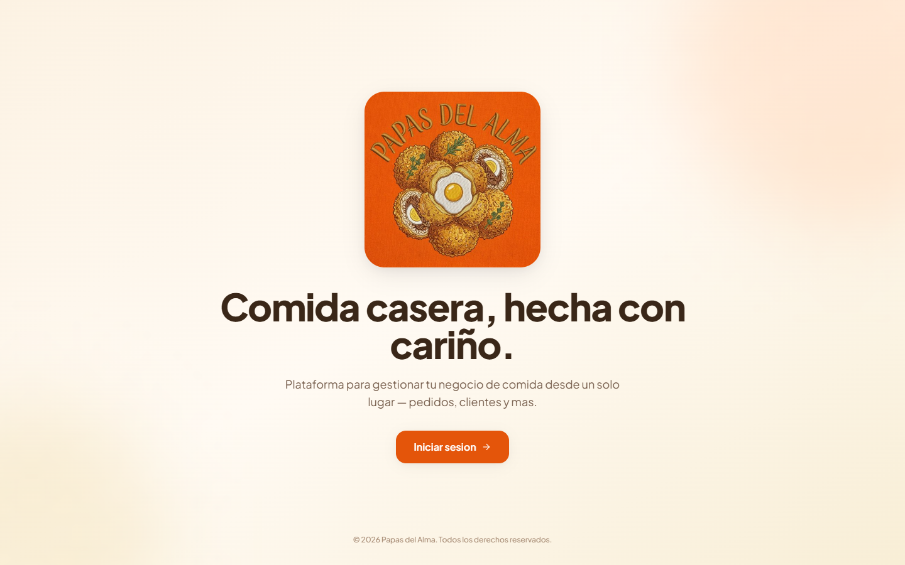
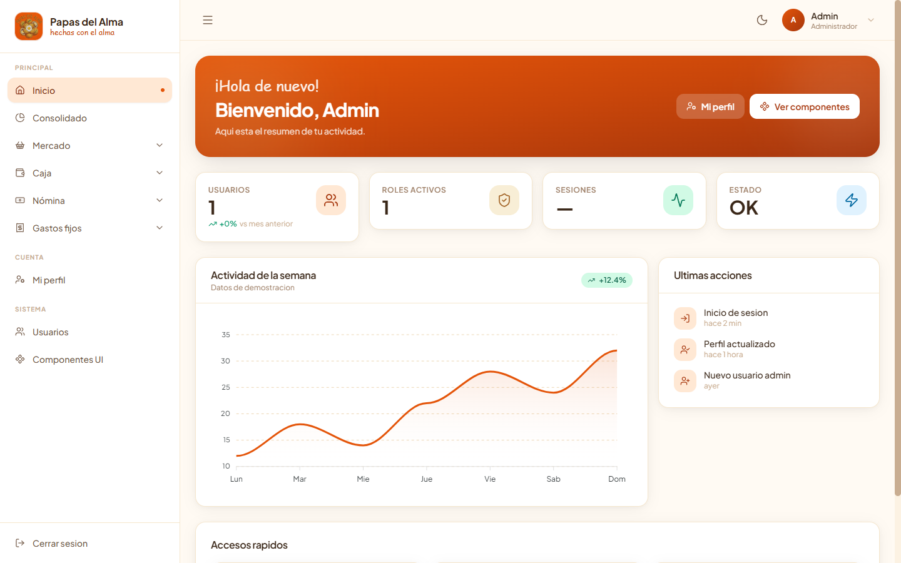
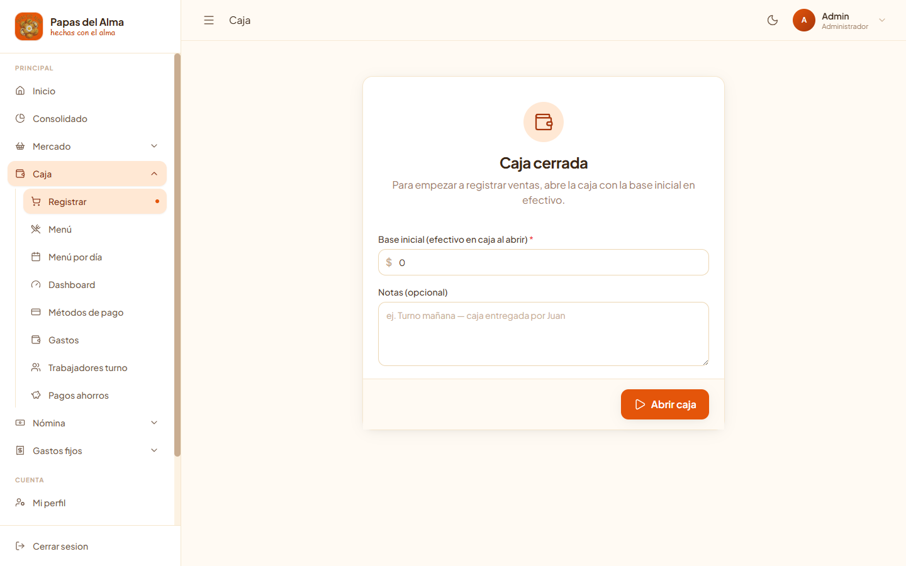
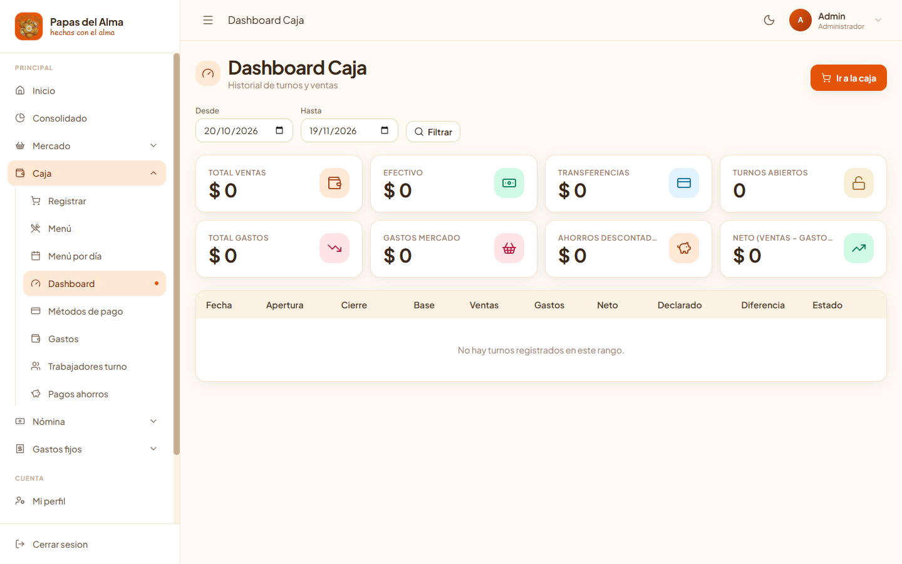
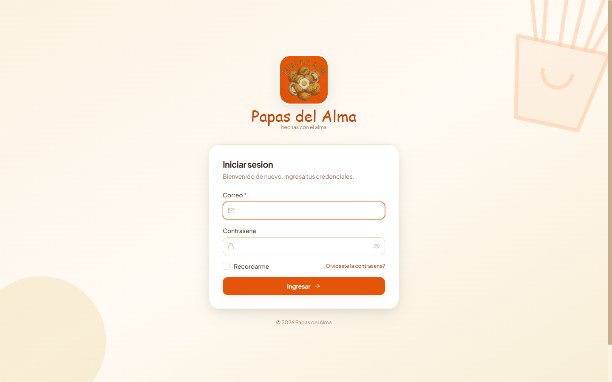

# Papas del Alma — POS y gestión de restaurante

Sistema de caja, menú, inventario, nómina y finanzas para un restaurante de comida casera.



## Contexto

Variante del sistema de restaurantes (ver Dorilokos / Sopas y Sopitas) desplegada para otro negocio de comida, con su propia identidad visual.

## Funcionalidades

- **Caja (POS):** turnos con base inicial, ventas, varios métodos de pago y cuadre de cierre.
- **Menú** con platos, combos, adiciones y menú por día.
- **Mercado e inventario** vinculado a la caja, con protección contra stock negativo.
- **Nómina** (empleados, prestaciones, ahorros, pagos masivos), **gastos y gastos fijos**.
- **Consolidado** de ingresos y egresos por método de pago.
- **API de solo lectura** para la app móvil *Mis Negocios*.

## Stack

- **Backend:** PHP 8, Laravel 9, MySQL/MariaDB
- **Autenticación y permisos:** Laravel Breeze + spatie/laravel-permission (roles y permisos)
- **Frontend:** Blade, Alpine.js, Tailwind CSS, Preline UI, ApexCharts, Tom Select, Lucide icons
- **API:** Laravel Sanctum

## Capturas

**Dashboard**



**Caja**



**Dashboard de caja**



**Inicio de sesión**



## Arquitectura

Este sistema forma parte de una familia de aplicaciones para restaurantes que comparten el mismo núcleo (caja, menú, mercado, inventario, nómina y finanzas) y se despliegan por separado para cada negocio, cada uno con su identidad visual y ajustes propios. La lógica de negocio vive en servicios (`app/Services`), los controladores se mantienen delgados y los assets se compilan con Vite para desplegar en hosting compartido sin Node en el servidor.

## Instalación local

Requisitos: PHP 8.0+ (con extensiones `gd`, `zip`, `intl`), Composer, Node 18+ y MySQL/MariaDB.

```bash
git clone <url-del-repositorio>
cd papasdelalma
composer install
npm install && npm run build
cp .env.example .env        # configura la conexión a la base de datos
php artisan key:generate
php artisan migrate --seed
php artisan serve
```

La aplicación queda disponible en `http://localhost:8000`. Los seeders crean los roles y datos iniciales (revisa `database/seeders`).

## Notas

- Proyecto desarrollado para un cliente real y desplegado en producción. Las capturas se tomaron en un entorno local; el historial de este repositorio se depuró para no incluir credenciales ni copias de bases de datos.

## Autor

**Santiago Bellaizán** — Desarrollador Full Stack (Laravel · PHP · MySQL · JavaScript)

- GitHub: [@Santibc](https://github.com/Santibc)
